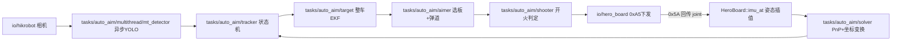

# 代码导读（heavy_standard 主链路）

给第一次读这套代码的人：先看这页，再按表跳到文件。符号与 EKF 约定见 [注释规范.md](注释规范.md)。

## 1. 一帧图像走过哪些文件

| 步骤 | 文件 | 输入 → 输出 | 单位 / 坐标系 |
| --- | --- | --- | --- |
| 取图 | `io/hikrobot/hikrobot.cpp` | 相机 → BGR + 取图时刻 | steady_clock 软时间戳 |
| 检测 | `tasks/auto_aim/multithread/mt_detector.cpp` + `yolos/yolov5.cpp` | 图 → `Armor`（像素角点、颜色、数字） | 像素 |
| 姿态 | `io/hero_board.cpp` `imu_at` | 0x5A 的 yaw/pitch 关节角 → 四元数 | 英雄 URDF：pitch 绕 -Y，抬头为正 |
| 解算 | `tasks/auto_aim/solver.cpp` | 角点 → `xyz_in_world` / `ypr_in_world` | 米、弧度，世界系 |
| 跟踪 | `tasks/auto_aim/tracker.cpp` | 装甲列表 → 0/1 个 `Target` | 先删非 `enemy_color` |
| 滤波 | `tasks/auto_aim/target.cpp` | 观测 → EKF `x vx y vy z vz a w r l h` | `w` 在下标 7 |
| 瞄准 | `tasks/auto_aim/aimer.cpp` | Target → `Command{yaw, pitch}` | 同济约定 pitch **抬头为负** |
| 开火 | `tasks/auto_aim/shooter.cpp` | Command + 云台 yaw → `shoot` | 容差单位度（yaml） |
| 下发 | `io/hero_board.cpp` `send` | Command → 0xA5（x=pitch, y=yaw, z=0/1/2） | 翻号成**抬头为正** |

打符：`tasks/auto_buff/buff_detector → buff_solver → buff_target → buff_aimer`，下发同上。
吊射：`tasks/lob_shot/manager.cpp`，不看图，输出本就是抬头为正，`send(..., false)` 不翻号。

## 2. 线程

| 线程 | 做什么 | 代码 |
| --- | --- | --- |
| 采集 | `camera.read`（或 `--video` 回放）；自瞄模式 `detector.push`，其它模式放 `latest` | `src/heavy_standard.cpp` `grab` |
| GPU | OpenVINO 异步推理，最多 3 帧在途 | `mt_detector.cpp` `start_async` |
| 主 | 取结果 → 跟踪 → 瞄准 → 下发 → 推曲线；每 0.5s 查 yaml 热加载 | `src/heavy_standard.cpp` `main` |
| 调试 | 缩放、画框、JPEG、发 Foxglove，最多 `debug.image_hz` 次/秒 | `tools/debug_sink.cpp` |
| 相机守护 | 断线重连 | `io/hikrobot/hikrobot.cpp` |
| 串口收 | 解析 0x5A，更新姿态/弹速/前哨位 | `io/hero_board.cpp` `rx_loop` |

主线程只做「算 + 发」，调试再慢也不拖控制帧率；图像只保留最新一帧，丢的是调试图不是控制。

## 3. 现象 → 看哪里、调什么

| 现象 | 先看 Foxglove 里的 | 调的参数（yaml，存盘即生效） | 代码 |
| --- | --- | --- | --- |
| 画面太暗/拖影 | `/raw` | `exposure_ms`、`gain` | `hikrobot.cpp` |
| 有车但没框 | `/vis` 灰/黄框、`detect_num` | `min_confidence`（需重启）、`enemy_color` | `yolov5.cpp` / `tracker.cpp` |
| 框是灰的 | `/vis` 标签颜色 | `enemy_color` | `tracker.cpp` 颜色过滤 |
| 一直 detecting 不进 tracking | `tracker_state` | `min_detect_count` | `tracker.cpp` |
| 一挡就丢 | `tracker_state` | `max_temp_lost_count` | `tracker.cpp` |
| 绿框和实物对不上 | `/vis` 绿框、`armor_x` vs `x` | 标定 `camera_matrix`、`R/t_camera2gimbal` | `solver.cpp` |
| 打高/打低 | `cmd_pitch` vs `gimbal_pitch` | `pitch_offset`（度） | `aimer.cpp` |
| 打左/打右 | `cmd_yaw` vs `gimbal_yaw` | `yaw_offset`（度） | `aimer.cpp` |
| 打陀螺总落后/超前 | `w`、`abs_w` | `high/low_speed_delay_time`、`decision_speed` | `aimer.cpp` |
| 陀螺时云台来回甩 | `nail_latched`、`w` | `nail_mode`、`nail_spin_on/off`、`nail_fire_window_deg` | `aimer.cpp` 钉头 |
| 跟上了但不开火 | `cmd_z`（1=跟踪 2=开火） | `first/second_tolerance`、`judge_distance`、`auto_fire` | `shooter.cpp` |
| EKF 抖、NIS 高 | `nis`、`residual_*` | EKF 噪声（`target.cpp` 内写死） | `target.cpp` |
| 帧率低 | `fps`、`cam_fps`、`latency_ms` | 相机插 USB3；`debug.image_hz` | `hikrobot.cpp` / `debug_sink.cpp` |
| 吊射不动 | `/debug` 的 `status` | `module_*` 门闩、`pitch_max_deg`、靶点坐标 | `lob_shot/manager.cpp` |

`fps` 是主循环处理帧率，`cam_fps` 是相机出帧率：二者差很多说明推理跟不上（看 `det_drop`），`cam_fps` 本身低说明是相机/USB。

## 4. `/debug` 字段（Foxglove 与 PlotJuggler 相同）

| 字段 | 含义 |
| --- | --- |
| `fps` / `cam_fps` | 主循环 / 相机帧率 |
| `latency_ms` | 取图时刻到下发完成，旧 `final_img` 的 Latency |
| `t_aim_ms` | 跟踪 + 瞄准 + 下发耗时 |
| `det_drop` | 推理在途已满而丢掉的相机帧（累计） |
| `detect_num` / `armor_num` | YOLO 全部检出 / 敌方色过滤后 |
| `tracker_state` | lost / detecting / tracking / temp_lost |
| `gimbal_yaw/pitch` | 由回传关节角算出的云台姿态（度，同济系） |
| `joint_yaw/pitch` | 0x5A 原始关节角（度，英雄系抬头为正） |
| `cmd_yaw/pitch` | Aimer 指令（度，同济系抬头为负） |
| `cmd_pitch_hero` | 实际下发的 pitch（度，抬头为正） |
| `cmd_z` | 0 不控 / 1 跟踪 / 2 开火 |
| `armor_x/y/z/yaw` | 当前帧单块装甲 PnP 结果（观测） |
| `x vx y vy z vz a w r l h` | EKF 状态（滤波） |
| `nis` `nees` `residual_*` | 卡方检验与残差 |
| `nail_mode` / `nail_latched` | 钉头开关 / 当前是否钉住 |
| `status` `yaw_deg` `pitch_deg` `z` | 吊射状态机（lob 模式） |

## 5. 热加载范围

存盘 yaml 或在 Foxglove 参数面板改值后 0.5s 内生效，日志打印 `[热加载] 已生效 [...]`。

| 改了 | 重建 / 生效 |
| --- | --- |
| `pitch_offset` `yaw_offset` 钉头、延时、容差、`fire_gap_time` `predict_time` | Aimer / Shooter / 打符 Aimer |
| `enemy_color` `min_detect_count` `max_temp_lost_count` … | Tracker（会丢当前目标） |
| `camera_matrix` `R/t_camera2gimbal` … | Solver + Tracker |
| `exposure_ms` `gain` | 相机即时生效 |
| `mode` `bullet_speed` `deploy` | HeroBoard（`mode` 可切 lob / buff） |
| 吊射靶点、门闩 `module_*` | lob 状态机（从 IDLE 重来） |
| `debug.image_hz/image_scale/jpeg_quality/raw` | 调试输出 |
| 其它（模型、`device`、`min_confidence`、串口、端口） | 日志提示「需重启」 |

面板改的值只在本次运行有效，并且会盖住磁盘 yaml 里同名 key；想永久生效请写回 yaml。
