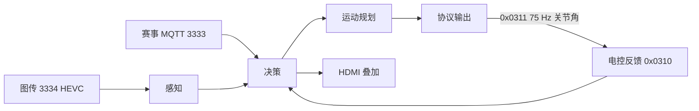

# 重装机器人自动对矿：技术路线

**目标**：资源站自动取矿，装配区完成 1–3 级；4 级扩展。
**边界**：计算全部在自定义终端；电控只做插补、限流、柔顺、看门狗；操作手选难度、确认、接管。

## 1. 架构



| 模块 | 职责 |
| --- | --- |
| 感知 | 解码、检测、PnP、多帧融合、选槽、灯环读角 |
| 决策 | 取矿 / 装配 / 恢复状态机 |
| 运动 | FK/IK、轨迹、碰撞检查 |
| 输出 | `0x0311`、AssemblyCommand、HDMI |

## 2. 感知

| 目标 | 特征 | 输出 |
| --- | --- | --- |
| 资源站 | station 点 + unit_end 点 | 槽位位姿、空/满、可达性 |
| 科技核心 | 12 点：pillar 5 + exchange 7 | 装配柱位姿 |
| 灯环 | 目标格队伍色 / 当前格白色 / 到位绿色 | Q 轴目标角 |

- PnP：RANSAC/SQPnP 初值，LM 精修；可见点 ≥5，重投影 <2 px。
- 多帧：静止取 3–5 帧，剔除超限帧，平移中值，旋转四元数平均。
- 模型：港科 `yolopose/v11.02` 基线，用图传画面微调。

## 3. 标定

| 量 | 方法 | 目标 |
| --- | --- | --- |
| 图传内参 | 圆点板 + `calibrate_camera` | 重投影 <0.5 px |
| 链路延迟 | LED 闪灯，统计发指令到画面变化 | 均值 + 分布 |
| 相机 → 臂基座 | 板装末端，20–30 个姿态 | 误差 <5 mm |
| 臂运动学 | URDF 名义参数；必要时触点修正 | 待机械臂定型 |

精度预算：1 m 处约 **5–8 mm、1°**；夹爪捕获范围 ≥±10 mm、±3°，不够时在 80 mm 处二次观察。

## 4. 规划

| 类型 | 场景 | 方法 |
| --- | --- | --- |
| I 型 | 固定重复动作 | 电控预置轨迹 |
| II 型 | 接近、回撤、恢复 | 6D 关节空间 BIT* |
| III 型 | 滑移、P、Q | 任务约束 + roll 离散 + 解析 IK + Viterbi |

III 型：

- 任务路径固定，末端只剩绕任务轴 roll 自由，即 5 自由度约束。
- 进度约 100 层 × roll 5°（72 个）× 固定 IK 分支。
- 边代价：关节运动 + roll 跳变 + 碰撞软代价 + 限位惩罚。
- 搜索失败：无效节点加大惩罚重搜，只修坏点，修复后复检碰撞。
- 碰撞：连杆胶囊 + 装配站网格，hpp-fcl；时间参数化用 Ruckig 或五次多项式。

## 5. 状态机

**取矿**：`SEARCH → LOOK → PRE_GRASP → VERIFY → ENGAGE → GRASP → PULL → STOW`

**装配**：`选难度 → 等核心 → LOOK → PRE_INSERT → INSERT 100 mm → SLIDE +Z 100 mm → P 90° → Q → RELEASE → 确认`

| 步骤 | 1 级 | 2 级 | 3 级 |
| --- | :-: | :-: | :-: |
| 插入 100 mm | ✓ | ✓ | ✓ |
| 滑移 +Z 100 mm |  | ✓ | ✓ |
| P 轴 90° |  |  | ✓ |
| Q 轴对准 |  |  | ✓ |

4 级：双核心，每步 5 s 内切换，总 45 s。

## 6. 通信

| 方向 | 包 | 频率 | 关键字段 |
| --- | --- | --- | --- |
| 终端 → 电控 | `0x0311` ≤60 B | 75 Hz | `q_ref[6]`、`dq_ff[6]`、`stiffness[6]`、mode、flags |
| 电控 → 终端 | `0x0310` ≤300 B | 50 Hz | `q[6]`、`dq[6]`、status、fault、effort |
| 终端 → 赛事 | AssemblyCommand | ≤10 Hz | operation、difficulty |
| 赛事 → 终端 | TechCoreMotionStateSync / Event 15 | 1 Hz / 事件 | 剩余时间、结果 |

链路：921600 8N1；帧头 `0xA5` + CRC8，帧尾 CRC16。包过期保持，500 ms 无包进入保持并置位。

## 7. 仿真

- 后端：港科 MuJoCo + ROS 2，已放入 `ore_sim/hkust_runtime`，尚未接入。
- 需补：ResourceStation（磁吸/拔出）、TechCoreReferee（等级/计时/Event 15）、LinkEmulator（延迟/丢帧/降质）。
- 指标：各级成功率、阶段耗时、失败原因分布。

## 8. 代码结构（目标）

```text
src/heavy_ore.cpp        入口
io/terminal/             终端链路
io/heavy_arm/            0x0310/0x0311 编解码、反馈、看门狗
io/simulation/           TCP 仿真桥
tasks/ore_vision/        检测、PnP、选槽、灯环
tasks/ore_motion/        FK/IK、轨迹、碰撞
tasks/ore_task/          取矿/装配状态机
tools/  calibration/     复用
configs/heavy_ore.yaml
tests/ore/               无硬件 ctest
```

## 9. 关键参数

| 项 | 值 |
| --- | --- |
| 控制频率 | 上行 75 Hz，下行 50 Hz |
| 关节分辨率 | 1e-4 rad |
| 插入深度 | 100 mm |
| 滑移 | +Z 100 mm |
| P 轴 | 90° |
| Q 轴 | ±90°，5° 精度 |
| 4 级 | 5 s 切换 / 45 s 总 |
| 精度预算 | 5–8 mm / 1° `[要调试]` |

## 10. 要调试

| 项 | 内容 |
| --- | --- |
| 机械臂 | 构型、连杆、限位、减速比、末端负载、夹爪捕获范围 |
| 图传 | 内参、延迟、手眼、安装位置与视场角 |
| 感知 | 资源站模型训练、灯环阈值、图传画质劣化 |
| 规划 | IK 分支、roll 步长、碰撞模型、规划耗时、Ruckig 参数 |
| 接触 | 磁吸力、拔出侧向力、插入卡死、松手回拉 |
| 通信 | λ 是否影响自定义协议、死人开关、实际时延与丢包 |
| 4 级 | 双核心同步、双收纳位是否必要 |

## 参考

- RMUC 2027 规则手册 V1.0.0（20261015）
- RMUC 2027 通信协议 V1.0.0（20261029）
- 港科 RM2026 工程装配算法：https://github.com/hkustenterprize/RM2026-Engineer-Assembly-Algorithm
