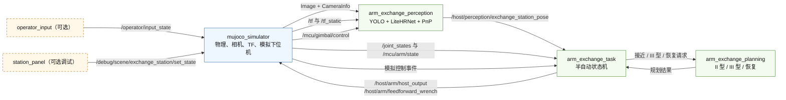

# 运行时工作区

本工作区把公开的感知、规划算法接到 ROS 2 Host 和 MuJoCo 仿真后端。图像、TF、关节状态使用标准 ROS 2 消息；任务命令和模拟下位机命令使用仓库自带的接口包。

当前版本只包含仿真后端，不含实机驱动和启动文件。以下命令默认在 `hkust_runtime` 根目录执行。

## 包结构

```text
hkust_runtime/
├── interfaces/    # Host 与仿真共用的 ROS 2 消息
├── core/          # 机器人模型、PnP、碰撞检查、运动规划
├── host/          # 感知、规划、任务编排节点
├── sim/
│   ├── mujoco_engine/       # 可复用的 MuJoCo 引擎与插件生命周期
│   └── arm_exchange_sim/    # 装配场景、插件、控制与资产
└── scripts/       # 构建、环境和测试脚本
```

详细说明：

- [数值核心与算法结构](core/README.md)
- [Host 节点与数据流](host/README.md)
- [装配 MuJoCo 应用](sim/arm_exchange_sim/README.md)
- [可复用 MuJoCo 引擎](sim/mujoco_engine/README.md)

## ROS 2 架构



`mujoco_simulator` 是一个 ROS 节点。机械臂控制器、操作逻辑、TF 发布、相机安装和装配站模型都是该节点内的应用插件，不是额外的 ROS 节点。`arm_exchange_perception` 仅在 `enable_perception:=true` 时启动；`operator_input` 仅在 `enable_operator_input:=true` 时启动。

`/host/arm/feedforward_wrench` 是预留的接触力前馈研究接口，默认关闭，不提供力传感器反馈或闭环力控。

### 后端边界

Host 节点只依赖 ROS 接口，不直接依赖 MuJoCo。仿真后端提供相机图像与内参、TF、关节与下位机反馈、操作事件和轨迹执行端点。公开版本只用 `mujoco_simulator` 实现这套接口；实机相机驱动、虚拟云台、编码器/MCU 传输和真实执行器接口未包含。

实机接入时，保留感知、规划、任务节点，替换仿真侧即可；但必须保持话题类型、坐标系、单位、时间戳和控制权限语义一致，并提供标定后的相机与并联机构变换。

## 环境适配说明

上游按 Ubuntu 22.04、ROS 2 Humble、Python 3.10 开发；原开发机环境为 Ubuntu 26.04、ROS 2 Lyrical、Python 3.14、RTX 4060 Laptop（8 GB）。

当前拷贝已把上游 `runtime/` 拍平到 `hkust_runtime/` 根目录，`scripts/build.sh` 与 `scripts/setup_env.sh` 已同步修改为按当前目录查找包、优先加载 `/opt/ros/lyrical`（兼容 `humble`）。但**虚拟环境 `.venv` 与模型权重 `weights/` 不在 Git 库中**：新机器需自备能导入 `mujoco`、`hppfcl`、`scipy`、`openvino`、`glfw`、`readerwriterlock`、`rclpy` 的 Python 环境（注意 Python 3.14 下 `mujoco==3.4.0` 与 `hpp-fcl==2.4.4` 没有现成 wheel，建议用 Python 3.10–3.12 或 conda/micromamba 提供 `hpp-fcl`），通过 `VENV=/path/to/venv ./scripts/build.sh` 编译。

## 本地配置

首次构建前生成本机配置：

```bash
cp core/arm_exchange_core/system_config.example.yaml \
  core/arm_exchange_core/system_config.yaml
```

模型权重需从 Hugging Face 下载，放到配置指定的 `weights/` 目录：

- `weights/yolo_v10.12_openvino_model`
- `weights/litehrnet30_v11.0_openvino_model`

也可修改本机 `system_config.yaml` 中的路径。`yolo_device` 和 `hrnet_device` 可分别设为 `GPU` 或 `CPU`；在本机上先用 `CPU` 验证流程，再切换显卡。

检查 OpenVINO 设备：

```bash
python3 - <<'PY'
from openvino import Core

core = Core()
for device in core.available_devices:
    print(device, core.get_property(device, "FULL_DEVICE_NAME"))
PY
```

## 构建

```bash
VENV=/path/to/venv scripts/build.sh
source scripts/setup_env.sh
```

脚本已兼容当前目录与 `lyrical` / `humble`。构建包含五个包：

- `arm_exchange_interfaces`
- `arm_exchange_core`
- `mujoco_engine`
- `arm_exchange_sim`
- `arm_exchange_host`

## 启动

正常交互流程同时启动感知、操作输入和仿真。需要可读的 Linux 键盘事件设备。

查找键盘：

```bash
ls -l /dev/input/by-id /dev/input/by-path
sudo apt install evtest
sudo evtest
```

优先使用稳定的 `by-id` 或 `by-path` 路径。当前用户需要读权限；加入 `input` 组后必须重新登录：

```bash
sudo usermod -aG input "$USER"
export KEYBOARD_DEVICE=/path/to/keyboard-event-device
id -nG | tr ' ' '\n' | grep '^input$'
test -r "$KEYBOARD_DEVICE" && echo "键盘可读"
```

启动完整仿真：

```bash
ros2 launch arm_exchange_host sim_host.launch.py \
  enable_perception:=true \
  enable_operator_input:=true \
  keyboard_device:="$KEYBOARD_DEVICE"
```

无感知、无操作输入的核心冒烟测试：

```bash
ros2 launch arm_exchange_host sim_host.launch.py
```

只测感知：

```bash
ros2 launch arm_exchange_host sim_host.launch.py \
  enable_perception:=true \
  camera_view:=true
```

启动参数：

- `enable_perception`：默认 `false`，启动 YOLO、LiteHRNet 和 PnP。
- `camera_view`：默认 `true`，显示感知叠加窗口。
- `enable_operator_input`：默认 `false`，启动原始键盘输入节点。
- `keyboard_device`：启用操作输入时必填。
- `sim_config_path`：覆盖 MuJoCo 应用 YAML。

装配站状态面板单独启动：

```bash
source scripts/setup_env.sh
ros2 run arm_exchange_sim station_panel
```

## 测试

```bash
scripts/test.sh
```

脚本会加载工作区、关闭无关的 pytest 插件，运行五个包的测试并输出 colcon 结果。

接口检查和仿真冒烟命令见 [装配仿真说明](sim/arm_exchange_sim/README.md)。
