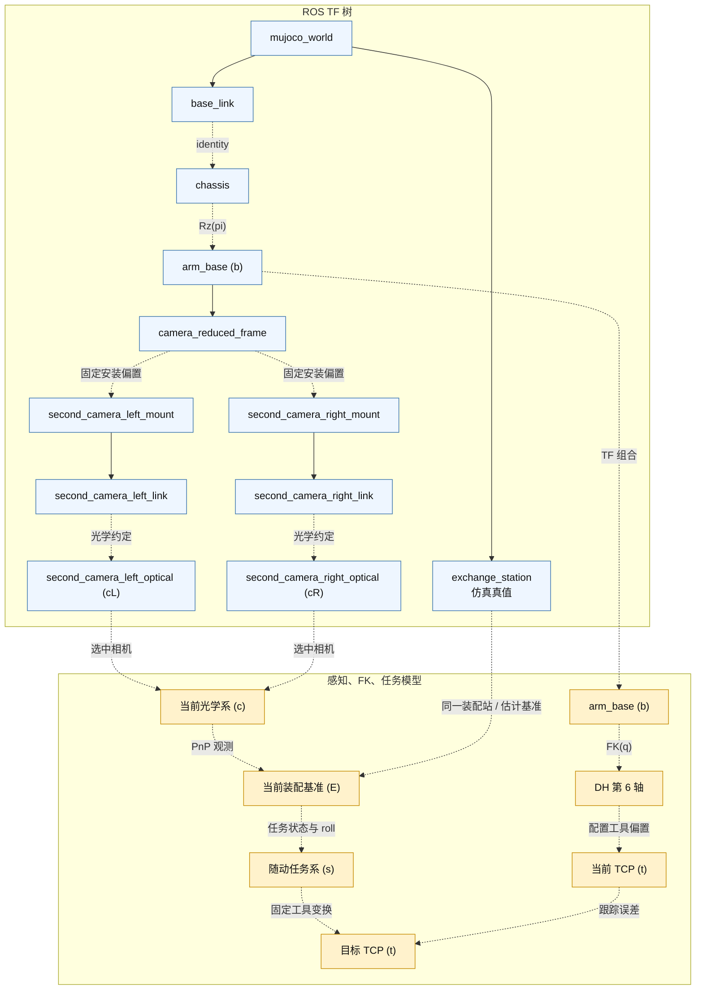

# 装配 MuJoCo ROS 2 仿真

本包提供公开装配仿真的插件、场景、资产和配置。可复用的执行循环、模型构建、插件生命周期和渲染由同级 `mujoco_engine` 提供。

## 启动

完整 Host + 仿真流程见[运行时说明](../../README.md)。只启动本 MuJoCo 应用：

```bash
source scripts/setup_env.sh
ros2 launch arm_exchange_sim arm_exchange_sim.launch.py
```

模型资产在 `arm_exchange_sim/model/model`，按当前 ROS 2 仿真打包方式放置。仿真模型可能随装配场景演进，和仓库级 `model/` 资产不完全一致。

## 应用插件

本包提供 `mujoco_engine` 加载的任务插件：

| 插件 | 职责 |
| --- | --- |
| `CameraMountPlugin` | 对模拟相机安装 mocap 刚体施加简化并联机构运动学 |
| `ArmExchangeTfPlugin` | 发布世界、底盘、机械臂、装配站、相机 TF |
| `ArmPlugin` | 模拟下位机权限、机械臂反馈和 Host 轨迹力矩控制 |
| `OperatorLogicPlugin` | 把原始操作输入转成模拟控制帧、底盘运动和相机控制 |
| `StationPlugin` | 把校验后的装配站规则变量写到 MuJoCo 关节和执行器 |

五个插件都在单个 `mujoco_simulator` 节点内执行；它们在 `simulation_config.yaml` 中的顺序就是每步回调顺序。

## 运行时接口

- 发布 `/tf` 和 `/tf_static`。
- 发布 `/joint_states`，类型 `sensor_msgs/JointState`。
- 订阅 `/operator/input_state`，类型 `arm_exchange_interfaces/OperatorInputState`。
- 订阅 `/host/arm/host_output`，类型 `arm_exchange_interfaces/ArmHost2MCUMsg`。
- 订阅 `/host/arm/feedforward_wrench`，类型 `arm_exchange_interfaces/ArmFeedforwardWrenchMsg`；默认关闭。
- 发布 `/mcu/arm/state`，类型 `arm_exchange_interfaces/ArmMCU2HostMsg`。
- 发布 `/mcu/arm/ctrl_start`、`/mcu/arm/ctrl_enter`、`/mcu/arm/ctrl_q`、`/mcu/arm/ctrl_withdraw`，模拟下位机控制帧。
- 发布 `/sim/mcu/arm_enabled`，类型 `std_msgs/Bool`，是模拟下位机的 Host 控制使能位；关闭时 Host 必须回到 IDLE。
- Host 控制使能且 Host 处于执行状态时，模拟下位机跟踪 `/host/arm/host_output`；未使能时把机械臂拉回配置的 `home_positions`。
- 发布 `/sim/state/operator_mode`、`/sim/state/control_authority`、`/sim/state/active_camera`。
- 发布 `/second_camera_left/image_raw`、`/second_camera_right/image_raw`，类型 `sensor_msgs/Image`，以及对应 `CameraInfo`。
- 订阅 `/debug/scene/exchange_station/set_state`，类型 `arm_exchange_interfaces/ExchangeStationState`。

## 力前馈研究接口

运行时保留一条开环力前馈路径，用于研究滑移、P 轴和手动 Q 轴阶段的接触保持。它的用途是在位置跟踪上叠加一个小接触力旋量，不替代几何轨迹或下位机反馈环。

Host 从运动装配坐标系中的名义压力和名义力大小出发，根据相邻任务位姿估计接触点切向，并去掉与切向平行的力分量：

```text
f_projected = f_nominal - t_hat (t_hat^T f_nominal)
```

投影后力留在局部法平面，不直接对抗规定任务运动。发布前检查保留力比例，并限制力和力矩幅值；力再转到真实 TCP 系。接触点相对 TCP 原点有偏移时，力矩为 `contact_offset x force`。

`ArmFeedforwardWrenchMsg` 携带使能位、Host 状态、保留力比例、TCP 力和 TCP 力矩。只有 Host 控制使能、消息新鲜、Host 状态属于支持的接触阶段时，仿真控制器才接受。`ArmModel.external_wrench_torque()` 把 TCP 力旋量映射成等效关节力矩：

```text
tau_command = tau_inverse_dynamics + tau_contact_feedforward + tau_PID
```

执行器符号转换和力矩限幅之前生效。消息停止更新时，超时把接触项清零，避免状态切换或 Host 失去权限后残留旧命令。

该路径**默认不启用**。配置中 `planning.exchange.feedforward_wrench.enabled: false`；公开运行时没有力/力矩传感器反馈、接触状态估计或闭环力控。消息、任务段投影和仿真侧力矩映射只作为后续力控研究的实验接口。启用前必须单独验证坐标系、力方向、接触位置、控制器稳定性和硬件限幅；仿真参数不能直接搬到实机。

## 操作输入

在另一个终端启动原始输入节点：

```bash
source scripts/setup_env.sh
export KEYBOARD_DEVICE=/path/to/keyboard-event-device
ros2 run arm_exchange_sim operator_input --ros-args \
  -p keyboard_device:="$KEYBOARD_DEVICE"
```

路径因机器而异。设备查找和 `input` 组权限设置见[运行时启动说明](../../README.md)。

按键：

- 按住 `w/a/s/d`：操作手模式下底盘 x/y 移动。
- 按住 `q/e`：操作手模式下底盘偏航。
- `1/2/3`：选择装配等级，保持操作手模式。
- `4`：选择手动 Q 轴模式。
- `tab`：切换操作模式。
- `c`：切换当前相机。
- 按住 `h/j/k/l`：遥操作模式下云台左/下/上/右。
- `esc`：把控制权限交还操作手。
- `x`：退出输入节点。

输入节点直接读 Linux `/dev/input/event*`，按 `publish_rate` 发布 `/operator/input_state`。键盘字段是当前按住状态；操作控制不使用原始鼠标事件。

左右第二相机使用独立 MuJoCo yaw/pitch 关节。按 `c` 切换当前视图，`h/j/k/l` 只调整当前视图。

## 坐标系

坐标模型同时包含 ROS TF 坐标系和只在感知、FK、规划内部使用的坐标系。图中蓝色节点通过 `/tf` 或 `/tf_static` 广播；橙色节点由算法计算，不作为额外 TF 子节点。实线 TF 边在仿真中会变化，虚线 TF 边启动后固定。



`mujoco_world -> base_link` 跟随底盘，`mujoco_world -> exchange_station` 跟随装配站。`base_link -> chassis` 在公开场景中为单位变换；`chassis -> arm_base` 施加机械臂模型使用的固定轴约定。规划、FK/IK 和感知输出都以 `arm_base` 为根。

仿真 `exchange_station` TF 是可视化和调试用真值。在线规划使用当前装配基准 `E`：PnP 在选中光学系 `c` 中估计 `E`，TF 组合再把它表达到 `arm_base`。操作手确认阶段后，任务节点可用当前 FK 重建 `E`。因此 `E` 是 `PoseStamped` 中的规划值，不一定等于持续广播的仿真真值坐标系。

`ArmModel.forward_kinematics()` 内部计算六个 DH 连杆系。最后一个 DH 系称为第 6 轴，加上配置的 `tcp_offset_6_tcp` 得到当前 TCP 系 `t`。第 6 轴和 TCP 目前都不作为 ROS TF 广播。III 型规划中，`E` 锚定随动任务系 `s`，装配状态、roll 和固定工具关系决定目标 TCP 位姿：

```text
T_b,t(q)      = T_b,6(q) T_6,t
T_b,t(target) = T_b,E T_E,s(state, roll) T_s,t
```

当前 TCP 和目标 TCP 之间的虚线表示控制器比较的跟踪误差，不是运动学树里的另一个变换。

### 并联相机机构

相机安装座通过并联机构与机械臂前两个关节机械耦合，因此不能表示成简单固定相机变换，也不能当成六轴 DH 链的普通串联延伸。`camera_reduced_frame` 是由关节 1、2 计算的虚拟简化系：位置跟随机构端点，姿态补偿并联机构。再与各相机安装座的固定变换、相机自身 yaw/pitch 关节和光学系约定组合。

仿真中简化运动学来自 `ArmModel`，其余安装/连杆偏置在启动时从 MuJoCo 模型直接量取。实机上制造公差、机构几何、相机安装和编码器零位使这些变换因机而异，因此需要专门手眼标定，用机械臂关节状态拟合相机关系，而不是把相机当作某个串联连杆上的固定刚体。

实机手眼标定脚本和采集数据**不在公开版本中**。仓库只发布仿真 TF 实现和运行时接口。移植到其他机器人时必须自己提供标定后的并联机构相机模型和固定光学外参；不能把仿真偏置直接用于实机。

### 光学约定

感知把 `/second_camera_*` 图像和 `CameraInfo` 当作 OpenCV 光学系：x 右、y 下、z 前。仿真显式发布 `second_camera_*_link -> second_camera_*_optical` 静态变换，因为 MuJoCo 相机约定不同。实机虚拟云台路径目前把 `link -> optical` 发布为单位变换，因为校正后的虚拟图像已经按 OpenCV/PnP 光学约定标注。也就是说，实机 `second_camera_*_link` 目前是光学系别名，不是物理相机本体系。如果以后把该 link 定义为物理系，虚拟云台图像生成必须先施加对应的固定 `link -> optical` 旋转，再用光学系 id 发布。

### 虚拟云台

实机设计用鱼眼相机获得宽视场，不机械转动相机。虚拟云台前端标定鱼眼投影，选择观察方向，把相关光线重投影成普通针孔图像。输出图像和 `CameraInfo` 使用关键点与 PnP 流程要求的 OpenCV 光学约定。相机切换和虚拟观察方向通过与仿真 yaw/pitch 相机关节相同的云台控制接口下发。

鱼眼标定、重投影实现和实机相机传输**不在公开版本中**。MuJoCo 后端直接渲染等效针孔视图，并发布相同的图像、标定和坐标系接口，让公开 Host 节点在没有实机相机栈时也能跑感知和任务流程。实机接入必须提供自己的虚拟云台或针孔相机前端，并保持这些 ROS 契约。

## 调试命令

```bash
ros2 run tf2_ros tf2_echo arm_base exchange_station
ros2 run tf2_ros tf2_echo arm_base second_camera_left_optical
ros2 topic hz /joint_states
ros2 topic hz /second_camera_left/image_raw
ros2 topic echo /second_camera_left/camera_info
```

命令冒烟：

```bash
ros2 topic pub --once /sim/mcu/arm_enabled std_msgs/msg/Bool "{data: true}"
ros2 topic pub --once /host/arm/host_output arm_exchange_interfaces/msg/ArmHost2MCUMsg \
  "{host_state: 3, position: [0.0, 0.3, 0.4, 0.0, 0.0, 0.0], velocity: [0.0, 0.0, 0.0, 0.0, 0.0, 0.0]}"
```

装配站状态冒烟：

```bash
ros2 topic pub --once /debug/scene/exchange_station/set_state arm_exchange_interfaces/msg/ExchangeStationState \
  "{x: -0.05, y: 0.2, z: 0.6, alpha: 0.0, theta: 0.0, phi: 0.0}"
```

`ExchangeStationState` 直接对应 MuJoCo/规则变量：`x, y, z, alpha, theta, phi`。仿真写对应 `level_*` 关节前会校验配置的规则范围。

## 装配站面板

在另一个终端启动 curses 面板：

```bash
source scripts/setup_env.sh
ros2 run arm_exchange_sim station_panel
```

面板在仿真配置的规则范围内编辑 `x, y, z, alpha, theta, phi`。上下选字段，左右调当前值，`[`/`]` 改步长，空格发布当前值，`r` 复位，`q` 退出。`Enter` 故意不绑定，避免和主操作确认键混淆。
