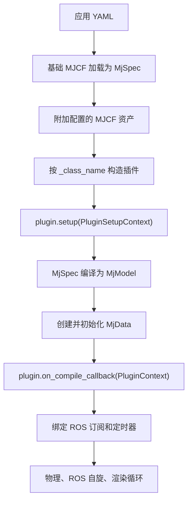

# MuJoCo 引擎

`mujoco_engine` 是面向配置驱动 MuJoCo 应用的任务无关 ROS 2 执行层。它负责模型组装、插件构造与生命周期分发、物理步进、相机渲染和 `simulator` 可执行文件。具体场景、控制和 ROS 接口留在应用包，例如 [`arm_exchange_sim`](../arm_exchange_sim/README.md)。

## 设计边界

引擎知道怎么运行 MuJoCo 模型，但不知道装配站、机械臂或操作模式是什么。它负责：

- 通过 ament 包索引解析绝对路径和 `package://` 资源；
- 把基础 MJCF 加载成 `mujoco.MjSpec`，可选附加其他 MJCF；
- 按 `_class_name` 构造配置中的 Python 对象；
- 把最终 `MjSpec` 编译成一个 `MjModel`，初始化 `MjData`；
- 把插件声明的 ROS 订阅和定时器绑定到生命周期回调；
- 按模型时间步运行 MuJoCo 物理循环；
- 渲染配置的 MuJoCo 相机，发布 `sensor_msgs/Image` 和 `CameraInfo`；
- 可选用 GLFW 窗口显示同一状态快照。

应用包持有 MJCF 资产、YAML 配置和 `BasePlugin` 实现。通用循环保持可复用，每个仿真自己定义执行器、反馈消息、控制和 TF 树。

## 启动与生命周期

`PluginSetupContext` 在编译前暴露可变 `MjSpec` 和 ROS 节点，插件可以在此创建发布者或改模型。编译后，`PluginContext` 暴露不可变模型结构、可变仿真数据、原始 spec 和节点。插件用 `on_compile_callback` 解析 MuJoCo 对象 ID、分配运行时状态。

执行时引擎分发三类回调：

| 回调 | 触发 | 职责 |
| --- | --- | --- |
| `on_step_callback` | 每次 `mj_step` 前 | 施加执行器控制或更新下一步模型状态 |
| `on_message_callback` | 配置的 ROS 订阅 | 把收到的命令转成仿真状态或控制器参考 |
| `on_timer_callback` | 配置的 `ros_events` 频率 | 发布反馈或其他周期状态 |

插件在 `ros_subscriptions` 中按 `话题 -> 消息类型` 声明订阅，在 `ros_events` 中按 `别名 -> 频率` 声明周期事件。引擎创建对应 ROS 实体并把话题或别名传回插件，应用插件不重复写订阅和定时器管线。

## 执行模型

物理在独立高频线程中按 `1 / model.opt.timestep` 运行。每次 MuJoCo 积分前，按配置顺序执行所有插件的 step 回调。ROS 回调用 `rclpy.spin_once`；相机和窗口渲染在主线程，因为 GLFW 要求窗口上下文归主线程。

权威 `MjData` 由公平读写锁保护。物理和改状态的插件回调拿写锁；渲染只在复制一致状态快照时短暂拿读锁，之后在锁外做 OpenGL 工作，不阻塞物理。每个配置相机有独立帧率，发布 Bayer RGGB 图像和由 MuJoCo 相机视场角计算的内参。渲染节奏与物理时间步分离，但图像和 `CameraInfo` 时间戳保持一致。

## 配置契约

应用 YAML 分六个引擎级段：

| 段 | 用途 |
| --- | --- |
| `build` | 基础场景和可选 MJCF 附件 |
| `initialization` | 可选关键帧和执行器控制初值 |
| `physics` | 物理循环诊断和选项 |
| `cameras` | MuJoCo 相机名、ROS 话题、光学坐标系、分辨率、帧率 |
| `visualization` | GLFW 窗口开关和窗口设置 |
| `plugins` | 有序插件定义和构造参数 |

引擎配置中的路径必须是绝对路径或 `package://<包>/<资源>`。公开应用使用包资源，安装后的 launch 文件不依赖源码树位置。

具体插件和 ROS 接口见[装配仿真说明](../arm_exchange_sim/README.md)。
