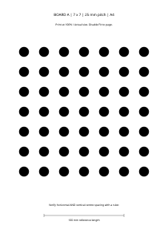
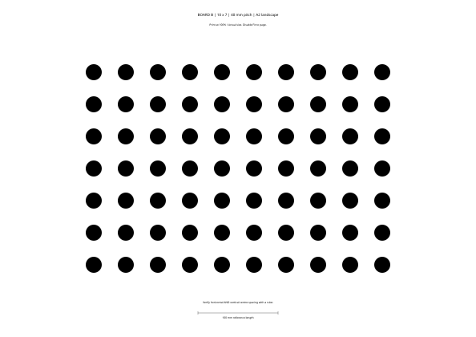

# 英雄视觉：工程说明与相机标定教程

本分支以本机 `sp_jlcv_aimer` 的目录分层为基准：`src` 放入口，`io` 放硬件适配，`tasks` 放算法，`tools` 放公共工具，`configs` 和 `assets` 放配置及模型。原先嵌套在 `tongji_hero/` 的当前程序已归入这些目录。

原有 Heavy 的吊射、钉头、打符、哨兵等入口，以及对应配置、模型、启动脚本和文档已退出当前工作区。`sp_jlcv_aimer` 与 `jlauto-aim` 两个独立仓库不属于此次清理范围。

本文提供工程结构、环境准备、离线内参标定、两种标定板和故障排查教程。handeye 部分说明通用原理、数据约定及现有实现限制，不提供该发射平台的实机手眼操作、瞄准外参接入或射击教程。

## 1. 阅读路线

| 目的 | 阅读位置 |
| --- | --- |
| 了解结构和构建 | 本文第 2～4 节 |
| 选择、打印标定板 | 本文第 5 节 |
| 内参拍摄、整理、解算和检查 | 本文第 6 节；[详细教程](docs/圆点标定操作流程.md) |
| 理解 handeye | 本文第 7 节；详细教程第 9 节 |
| 查看相机检查与来源记录 | [英雄入口说明](docs/hero.md) |

命令默认从本仓库根目录执行，克隆目录不同则替换路径：

```bash
cd ~/Heavy
git status --short --branch
```

## 2. 目录与模块

```text
Heavy/
├── CMakeLists.txt                 根构建入口
├── src/hero.cpp                   当前英雄程序入口
├── io/
│   ├── CMakeLists.txt             相机模块
│   ├── camera.*                   相机接口
│   ├── hikrobot/                  当前海康驱动
│   └── hero/                     英雄接口与配置校验
├── tasks/
│   ├── auto_aim/                  当前视觉算法
│   └── auto_outpost/              当前前哨站模块
├── tools/                        公共工具与独立 CMake 目标
├── configs/
│   ├── hero.yaml                  当前入口配置
│   ├── calibration.yaml           7×7、25 mm 板配置
│   ├── calibration_10x7.yaml       10×7、40 mm 板配置
│   └── camera_info.yaml           历史参考内参
├── assets/                       当前入口所需模型
├── calibration/                  内参与两套 handeye 离线工具
├── tests/hero/                    当前入口的已有回归检查
└── docs/
    ├── hero.md
    ├── 圆点标定操作流程.md
    └── calibration_boards/        两种板的 SVG 与 PDF
```

与参考仓库保持的是分层和模块职责。这里保留英雄需要的模块，没有复制步兵、哨兵或其他未使用的入口。`io/hero/` 对应参考仓库中独立硬件适配层的位置；算法继续使用当前已迁移的版本。

`configs/camera_info.yaml` 带有 `source: remote_hero_untuned`，只是历史相机数据。新内参结果另存实验目录，不会自动覆盖 `configs/hero.yaml`。

## 3. 环境准备

参考系统为 Ubuntu 22.04。公共 C++ 依赖：

```bash
sudo apt-get update
sudo apt-get install -y \
  build-essential cmake git \
  libopencv-dev libeigen3-dev \
  libfmt-dev libspdlog-dev libyaml-cpp-dev \
  nlohmann-json3-dev
```

安装需要本机权限与可用软件源。完整入口额外依赖 OpenVINO Runtime；海康实机采集还需要与系统架构匹配的 MVS SDK。离线标定不需要 OpenVINO、MVS、ROS 或串口。

## 4. 构建方式

### 4.1 默认构建当前入口与标定工具

默认启用 `BUILD_HERO=ON`、`BUILD_CALIBRATION=ON`，测试由标准的 `BUILD_TESTING` 控制。不再使用旧构建开关或嵌套工程。

```bash
cmake -S . -B build -DCMAKE_BUILD_TYPE=Release \
  -DOpenVINO_DIR=/opt/openvino/2026.4.1/openvino/cmake
cmake --build build -j4
ctest --test-dir build --output-on-failure
```

`OpenVINO_DIR` 指向包含 `OpenVINOConfig.cmake` 的目录。另一台已安装 2024.6 的机器可能使用 `/opt/intel/openvino_2024.6.0/runtime/cmake`，请按实机安装位置填写，不要照搬版本路径。

主要产物为 `build/hero`、`build/calibrate_camera`、`build/calibrate_handeye` 与 `build/calibrate_robotworld_handeye`。相机、模型与算法分别通过 `io`、`auto_aim`、`auto_outpost`、`tools`、`hero_io` 目标组织，根入口负责链接。

### 4.2 只构建离线标定工具

```bash
cmake -S . -B build/calibration \
  -DBUILD_HERO=OFF \
  -DBUILD_CALIBRATION=ON
cmake --build build/calibration -j4 --target calibrate_camera
./build/calibration/calibrate_camera --help
```

该模式不查找 OpenVINO 或 MVS。两套已有 handeye 工具仍保留，按需构建对应目标即可。它们的输入假设和限制见详细教程。

使用新构建目录，避免沿用旧工程的 CMake 缓存。内存不足时将 `-j4` 改为 `-j2` 或 `-j1`。

## 5. 两张标定板：选择、下载和打印

这里的“两张”按仓库已有的两种板规格整理。它们都是**白底黑圆点、对称圆点阵**，不是棋盘格或错列圆点阵；列数与行数数的是圆点。

| 项目 | 小板 A | 大板 B |
| --- | --- | --- |
| 圆点排列 | 7 列 × 7 行，共 49 点 | 10 列 × 7 行，共 70 点 |
| 相邻圆心距 | 25 mm | 40 mm |
| 首末圆心跨度 | 150 × 150 mm | 360 × 240 mm |
| 本次模板圆点直径 | 12.5 mm | 20 mm |
| 模板纸张 | A4 竖向，210 × 297 mm | A2 横向，594 × 420 mm |
| 对应配置 | `configs/calibration.yaml` | `configs/calibration_10x7.yaml` |
| 可打印 PDF | [小板 A](docs/calibration_boards/circles_7x7_25mm_A4.pdf) | [大板 B](docs/calibration_boards/circles_10x7_40mm_A2.pdf) |
| 矢量 SVG | [小板 A](docs/calibration_boards/circles_7x7_25mm_A4.svg) | [大板 B](docs/calibration_boards/circles_10x7_40mm_A2.svg) |

模板圆点直径是本次设计值；已有实体板以实测为准。`center_distance_mm` 表示圆心距，不是圆直径或两圆边缘之间的空隙。

打印选择 **100% / 实际大小**，关闭“适合页面”和自动缩放。大板需要 A2 设备或打印店，不能缩到 A4 后继续填写 40 mm。

打印后用尺检查底部 100 mm 标尺，以及多组横向、纵向圆心距。再平整贴到硬板上，避免波浪、翘曲和反光。浏览器预览尺寸不能代替实测。





两种板是替代选择。当前工具一次解算只接受一种规格，不能把两种板的照片放在同一输入目录中。

## 6. 内参标定：从拍照到结果

### 6.1 固定相机设置

确认镜头、焦距、对焦和分辨率，记录 ROI、裁剪、像素合并等设置。拍摄期间固定这些设置，关闭会改变焦距或对焦位置的自动功能。

保存未缩放、未去畸变的原始分辨率图片，不要使用远程桌面截图。所有图片必须具有相同宽高。

### 6.2 拍摄有差异的图片

将完整板分别放在画面中心、边缘和四角，改变距离及板面倾斜方向。每次停稳、图像清晰后再保存。每张都应看见全部圆点，避免反光、运动模糊或遮挡。

先采 20～30 张作为起点，关键是位置与角度覆盖，不是连续拍很多相似照片。不同批次、不同板、不同分辨率分别建目录。

### 6.3 整理连续编号

以小板 A 为例：

```bash
mkdir -p datasets/intrinsic_7x7/images
mkdir -p datasets/intrinsic_7x7/results
cp configs/calibration.yaml datasets/intrinsic_7x7/board.yaml
```

将图片整理为：

```text
datasets/intrinsic_7x7/
├── board.yaml
├── images/
│   ├── 1.jpg
│   ├── 2.jpg
│   ├── 3.jpg
│   └── ...
└── results/
```

工具从 `1.jpg` 起逐张读取，遇到第一张缺失或无法读取的图片就停止。不能跳号，不能只改扩展名把 PNG 当作 JPEG。**内参工具不读取姿态 TXT**，无需串口反馈。

### 6.4 运行解算

```bash
./build/calibration/calibrate_camera datasets/intrinsic_7x7/images \
  --config-path=datasets/intrinsic_7x7/board.yaml \
  --camera-info=datasets/intrinsic_7x7/results/camera_info.yaml \
  --output=datasets/intrinsic_7x7/results/intrinsics_flat.yaml \
  --preview=none
```

使用 `--参数=值`。这里显式指定输出路径，防止默认覆盖仓库中的 `configs/camera_info.yaml`。程序不会创建输出父目录，因此必须提前 `mkdir -p`。

有桌面显示时，可将 `none` 改成 `auto` 快速预览，或 `manual` 逐张按键查看；SSH 没有图形显示时使用 `none`。

大板 B 的完整命令、图片整理脚本和参数说明见[详细教程](docs/圆点标定操作流程.md)。

### 6.5 阅读与检查输出

终端逐张打印 `[success]` 或 `[failure]`，失败样本跳过。现有程序只要有有效样本就可能继续求解，**退出码为 0 不等于样本充分或结果可靠**。

输出包括：

- `camera_info.yaml`：图像宽高、3×3 内参矩阵、五项畸变系数；采用 ROS 风格格式，但不需要 ROS。
- `intrinsics_flat.yaml`：`camera_matrix` 与 `distort_coeffs` 两个扁平字段。
- 注释中的重投影误差：所有有效圆点的二维欧氏误差算术平均，单位像素；不是 OpenCV 的 RMS 返回值。

```text
K = [ fx   0  cx ]
    [  0  fy  cy ]
    [  0   0   1 ]

D = [k1, k2, p1, p2, k3]
```

`fx/fy` 是以像素为单位的焦距，`cx/cy` 是主点。当前工具用 `CALIB_FIX_K3` 固定 `k3`，不代表镜头没有更高阶畸变。

检查宽高与照片一致、数值有限、`fx/fy` 为正、独立重拍时结果可重复，并用未参与拟合的照片检查去畸变表现。平均误差小只是其中一项指标。

## 7. handeye 与内参有什么关系

**内参**描述相机如何把三维点投到图像；**手眼标定**描述相机与另一个刚体坐标系之间的固定变换。

| 项目 | 相机内参 | 通用手眼标定 |
| --- | --- | --- |
| 典型输入 | 板图片、圆心几何 | 图片、已知内参、与图片同步的刚体位姿 |
| 典型输出 | `K`、`D`、图像尺寸 | 坐标系间的旋转 `R` 与平移 `t` |
| 是否需要姿态文件 | 本仓库内参工具不需要 | 现有手眼实现需要配对姿态 |
| 标定板数量 | 一种板、多种视角 | 不因叫 handeye 就必须换第二块板 |

两张板不分别绑定“内参”和“手眼”。通用手眼还需明确 eye-in-hand / eye-to-hand、变换方向、单位和时间同步，不能把任意 `R/t` 当作可互换结果。

解释、矩阵记号和现有实现限制见[详细教程](docs/圆点标定操作流程.md)第 9 节。该节不提供此平台的实机操作或瞄准配置接入步骤。

## 8. 常见问题

| 现象 | 先检查什么 |
| --- | --- |
| 无有效内参样本 | 路径、`1.jpg`、图片是否可读、板规格是否一致 |
| 有很多图片却只读几张 | 编号断档或中间图片损坏 |
| 所有图片检测失败 | 对称圆点阵类型、点数、黑白方向、反光和清晰度 |
| 远处圆点检测失败 | 圆点像素大小是否落在 blob 面积范围内 |
| 无法连接图形显示 | 改用 `--preview=none` |
| 参数被当作 `true` | 使用 `--config-path=...` 等等号写法 |
| 输出不存在或未更新 | 输出父目录与写权限；写文件辅助函数未检查流错误 |
| 新内参与旧值不同 | 镜头、焦距、分辨率是否不同；旧值是否只是参考 |
| 小误差但参数不稳定 | 图片是否相似、覆盖不足、板是否弯曲 |

## 9. 清理与历史记录

此次整理移除了旧 Heavy 入口与专属资源，将当前英雄程序移入根目录模块，保留 Git 历史与仓库外的清理前快照。清理没有修改相机设置、串口协议或算法计算逻辑。

2026-11-05 之前的记录中，1000 帧相机测试采集约 165 FPS，完整视觉处理约 100～106 FPS；仍有跟踪重建等未解决问题。目录整理和离线回归不能替代实机验收。
