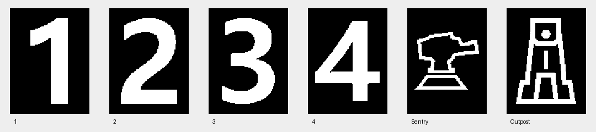

# 可视模型参考与边界

查阅日期：2026-11-06。模型实现位于 `apps/viewer/rendering/models.hpp`，渲染位于 `apps/viewer/rendering/mesh_renderer.hpp`。
保持白底、红蓝灯条和精简界面；资料说明仅放在文档中。

## 已查阅的来源

| 来源 | 查阅情况 | 本次用途 |
| --- | --- | --- |
| [RoboMaster 官方 2027 规则资料](https://bbs.robomaster.com/wiki/20204847/1969149?source=7) | 已阅读规则手册 V1.0.0 第 54 页图 4-31/4-32、56 页图 4-34 | 能量机关五灯臂、双立柱、镂空臂、靶环；前哨站分段塔身、三层装甲支架。靶中心、转速等仍由核心参数决定 |
| [官方 RMU 2026 场地图纸及可移动道具](https://bbs.robomaster.com/article/814728) | 已确认 RMUC V2.0.0 STEP 下载入口；文件约 1.25 GB，未下载或解析整场 CAD | 记录可用于后续提取原始场地网格的官方入口；本次模型不宣称来自 STEP 转换 |
| [青岛大学未来战队 RM2026 全向轮步兵机械开源](https://bbs.robomaster.com/article/1935501) | 已阅读配套《全向轮步兵技术报告》第 9 页图 16/17、第 12 页图 20；未导入 CAD | 车辆只参考底盘：井字铝方管、斜置全向轮、滑轨轮组、外围防撞框及分区设备布局 |
| [香港科技大学 ENTERPRIZE 环数检测能量机关机械开源](https://bbs.robomaster.com/article/9656?source=5) | 已确认开源清单包含完整 STEP、SolidWorks 与生产 2D 图纸；未下载网盘装配体 | 后续机械细节参考入口；本次机关外形尺寸以官方手册为主 |

官方场地 CAD：[RMUC2026_V2.0.0.stp](https://bbs-web-static.robomaster.com/f637e13eadfc4602a76c7a05c54f71271782803452461/RMUC2026_V2.0.0.stp)。
官方注明模型仅供参考，与规则手册或比赛现场不符时以手册和现场为准。

## 实现范围

当前显示浮空装甲板与圆靶。已移除旧的车架、轮组、防撞框、设备盒、前哨塔身、机关立柱及连接支架。
上面的来源保留作历史参考，不代表当前渲染中仍有对应机械结构。

- 车辆：四块装甲板，保留黑色外壳、红蓝双灯条和可选的 2026 标识（英雄 1、工程 2、步兵 3/4、哨兵炮塔图案）。
- 前哨站：三块装甲板，使用前哨塔形标识，保持核心给定的半径、倾角、高度和转速。
  默认高度沿递增几何相位按高→中→低排列；正转、反转共用相同装配顺序。
- 能量机关：五个独立圆靶，保留靶环与激活灯色。
- 简单方向光、CPU 深度缓冲和 2×采样负责表面显示、装甲间遮挡与边缘平滑。

Qt 和相机渲染器均只绘制受击表面。`Surface` 的位置、朝向、尺寸及弹丸碰撞逻辑保持不变。
装甲灯条与数字仍为合成外观，不能替代实机标定。

## 相机成像层

相机现已支持图像输出，见 [CAMERA.md](../CAMERA.md)。`modules/camera/src/image.cpp` 使用独立的、
不依赖 Qt 的简化成像几何和深度缓冲；不是把本文件所述的观察窗口截图作为相机输入。
两种视图共享世界快照，但相机视角由内参和执行器安装外参决定。
2026 标识从官方制作规范手册 V2.0.0 附录图 1–6 提取，UI 与相机共用一套二值掩码，无运行时字体替代；见 [来源与处理说明](../../modules/camera/assets/README.md)。

